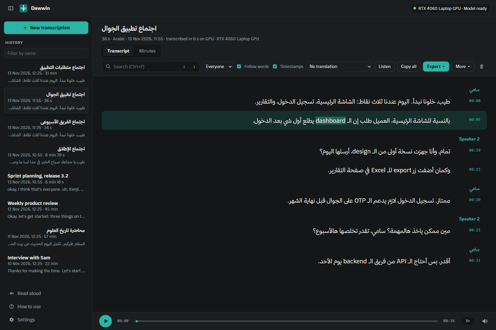
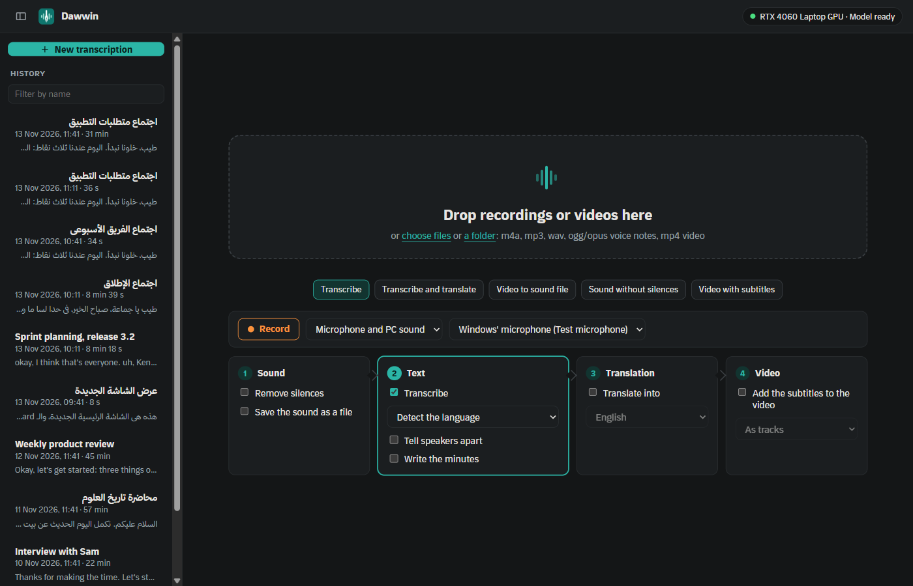
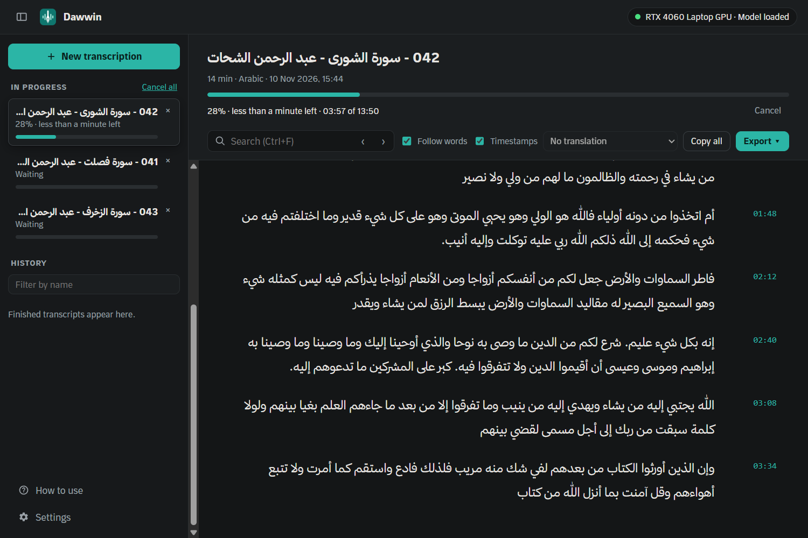
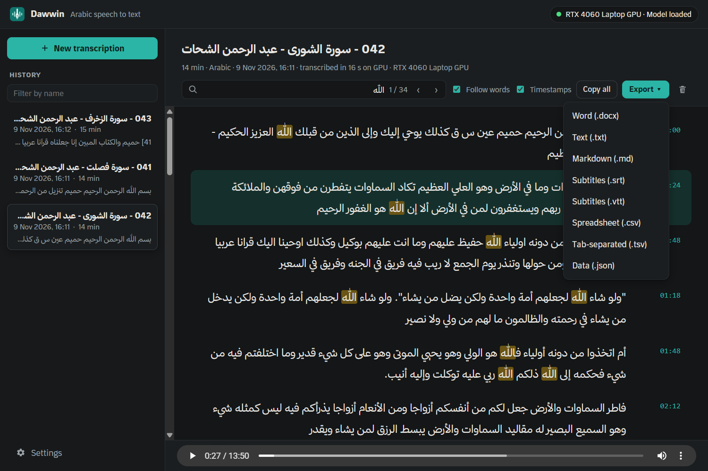
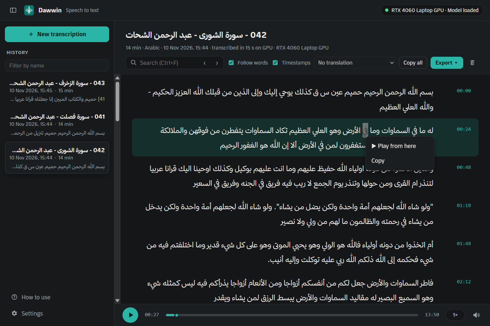
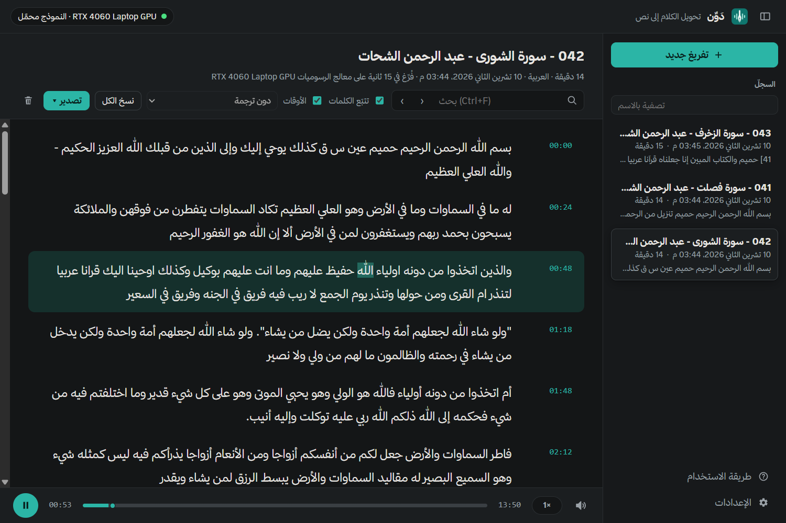
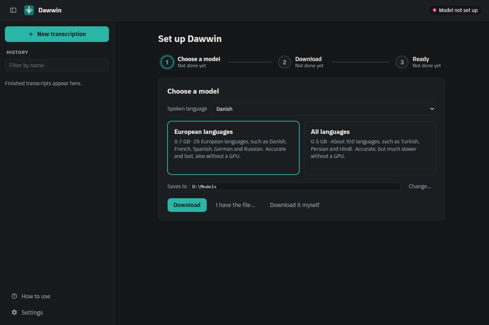

# Dawwin · دَوِّن

*Dawwin* means "write it down" in Arabic.

Turn recordings into text on your own Windows PC, in Arabic and about 100 other languages. For Arabic,
Dawwin runs the open
[Cohere Transcribe Arabic](https://huggingface.co/CohereLabs/cohere-transcribe-arabic-07-2026) model,
which handles dialects (Syrian, Gulf, Egyptian, …) and Arabic mixed with English terms. Other languages
get [NVIDIA Canary](https://huggingface.co/nvidia/canary-1b-v2) or
[OpenAI Whisper](https://huggingface.co/openai/whisper-large-v3-turbo). Your recordings and transcripts
never leave the computer.

**[Download the latest release](https://github.com/BaraaJadaan/dawwin/releases/latest)**



## Features

- Drop recordings on the window: m4a, mp3, wav, WhatsApp voice notes, flac, mp4 video. Several files queue up.
- Transcribe a whole folder, subfolders included. The transcripts are saved next to the recordings, and
  recordings that are already done are skipped, so a stopped run picks up where it left off.
- Choose the spoken language, and Dawwin uses the model that suits it. If that model is not on the PC
  yet, it offers to download it.
- The transcript appears line by line, in the direction of its language, with timestamps.
- **Follow words**: the word being said is highlighted as the recording plays. Ctrl+click a word, or
  select text and right-click → **Play from here**, to hear it.
- Correct lines in place, search (أ/إ/ا, ة/ه and ى/ي match), and export to Word, text, Markdown,
  subtitles (SRT, VTT) or data (CSV, TSV, JSON).
- Runs on the GPU of any brand (NVIDIA, AMD, Intel), or on the CPU when there is none.
- English or Arabic interface.

<table>
  <tr>
    <td width="50%"><br>Drop recordings on the window, or choose a whole folder.</td>
    <td width="50%"><br>Read the text while it is being written. The rest of the queue waits its turn.</td>
  </tr>
  <tr>
    <td><br>Search the transcript and export it in eight formats.</td>
    <td><br>Select a word and right-click to hear it being said.</td>
  </tr>
  <tr>
    <td><br>The whole interface also comes in Arabic, right to left.</td>
    <td><br>Choose a language and a model. The download survives pausing, closing the app and a lost connection.</td>
  </tr>
</table>

## Getting started

1. Download `Dawwin_x.y.z_x64-setup.exe` from
   [Releases](https://github.com/BaraaJadaan/dawwin/releases) and run it. Windows may say the app is
   unrecognised: choose **More info → Run anyway**. Or use the portable `.zip`: unpack it and run `dawwin.exe`.
2. Choose the language of your recordings, then a model. No account is needed, and you only need the
   models for the languages you use.

   | Model | For | Download | |
   | --- | --- | --- | --- |
   | **Arabic, full quality** (Cohere Q8) | Arabic with its dialects, English | 2.4 GB | The most accurate. About 3 GB of GPU memory. |
   | **Arabic, smaller** (Cohere Q4) | Arabic with its dialects, English | 1.6 GB | Almost as accurate. For weaker PCs and slow connections. About 2 GB of GPU memory. |
   | **European languages** (Canary 1B v2) | 25 languages: Danish, French, Spanish, German, Russian, … | 0.7 GB | Accurate and fast, also without a GPU. |
   | **All languages** (Whisper large-v3 turbo) | About 100 languages: Turkish, Persian, Hindi, … | 0.5 GB | Accurate, but much slower without a GPU. |

   The download can be paused. If the connection drops or Dawwin closes, it carries on from where it
   stopped. Already have the file? Press **I have the file**: any Cohere Transcribe, Canary or Whisper
   GGUF file works.
3. Drop a recording on the window.

With the Arabic model on an RTX 4060 laptop GPU, 24 minutes of audio take about 40 seconds. On an 8-core
laptop CPU, it runs about 3 to 4 times faster than real time. On a small cloud CPU without a GPU, Canary
ran about 7 times faster than real time, and Whisper about as fast as real time.

**Requirements:** Windows 10 or 11 (64-bit), 8 GB of RAM, and room for the model. For WhatsApp voice
notes (opus), install ffmpeg: `winget install Gyan.FFmpeg`.

## Building from source

You need [Rust](https://rustup.rs), the Visual Studio C++ Build Tools, CMake and Node.js. For GPU
support, also the [Vulkan SDK](https://vulkan.lunarg.com); without it the engine is built for the CPU.

```bash
npm install
npm run engine
npm run build
```

The installer and a portable zip of the current version land in `dist/`, with their checksums.

How the app is put together, and how to release it: [docs/how-it-works.md](docs/how-it-works.md).

## Contributing

Contributions are welcome: bug reports, fixes, translations and new features. Please contact me
before starting on something bigger, so we can agree on the approach: open an
[issue](https://github.com/BaraaJadaan/dawwin/issues) or reach me on GitHub
([@BaraaJadaan](https://github.com/BaraaJadaan)). Then send a pull request.

## Privacy

Dawwin goes online only when you ask it to: to download a model (from
[Hugging Face](https://huggingface.co)), and to check for updates (from GitHub; also at startup if you
turn that on in Settings).

## Uninstall

Uninstall Dawwin from Windows Settings → Apps. The models and your transcripts are kept in case you
reinstall. To remove them too, delete the folders `%LOCALAPPDATA%\Dawwin` and `%APPDATA%\Dawwin` (and
the model folder, if you chose another place for it).

## License

[MIT](LICENSE). Three things are not part of this repository and have their own terms:

- **The models**: Cohere publishes its model under Apache-2.0, NVIDIA publishes Canary under CC BY 4.0,
  and OpenAI publishes Whisper under the MIT license. Dawwin downloads GGUF conversions of
  [Cohere](https://huggingface.co/handy-computer/cohere-transcribe-arabic-07-2026-gguf),
  [Canary](https://huggingface.co/handy-computer/canary-1b-v2-gguf) and
  [Whisper](https://huggingface.co/handy-computer/whisper-large-v3-turbo-gguf) made by the
  [transcribe.cpp](https://github.com/handy-computer/transcribe.cpp) project.
- **The engine**: [transcribe.cpp](https://github.com/handy-computer/transcribe.cpp), under the MIT license.
- **The font**: official builds embed [Thmanyah Sans](https://font.thmanyah.com), © Thmanyah Publishing
  and Distribution. Its license does not allow sharing the font files, so builds from this repository
  use the system font instead.
