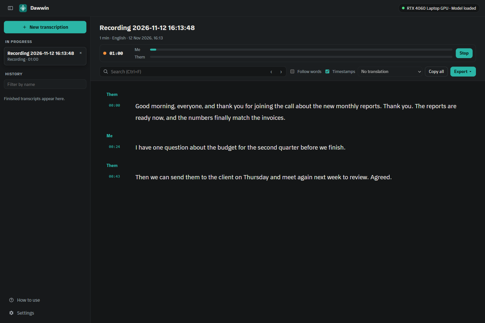
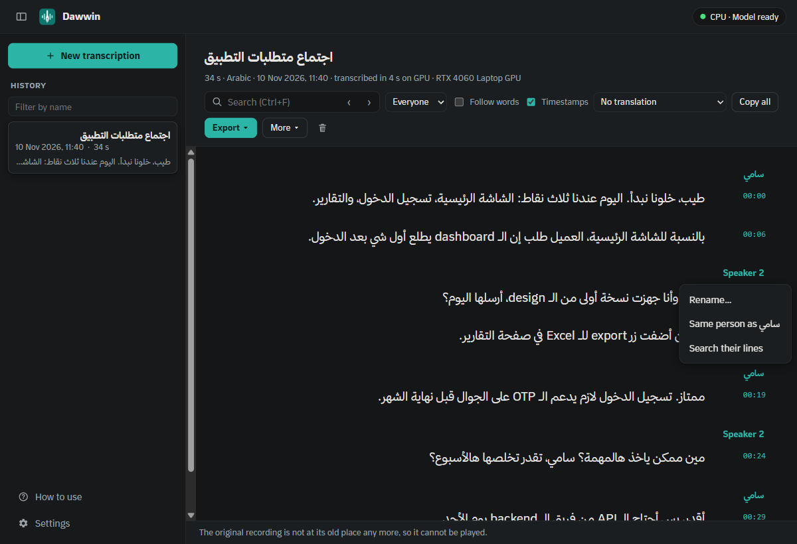
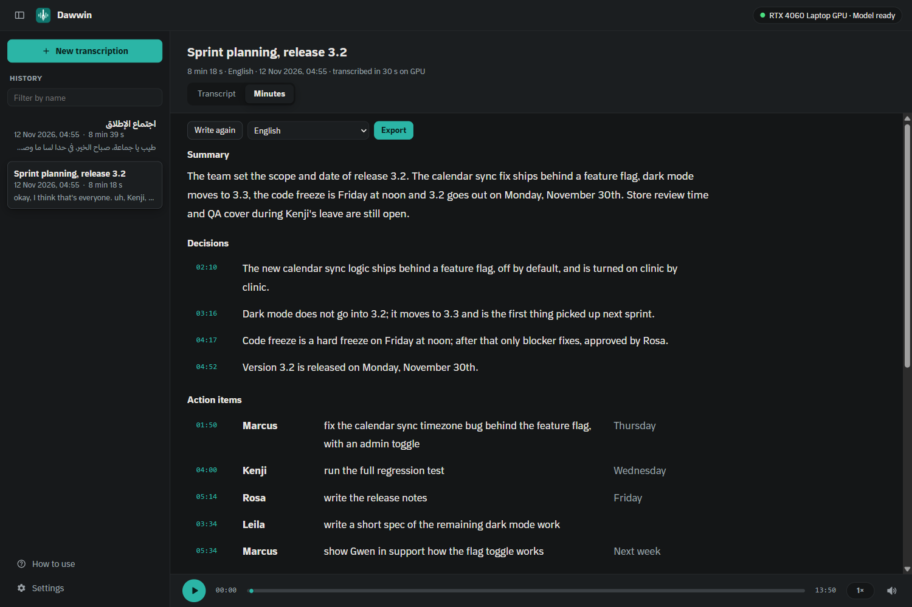
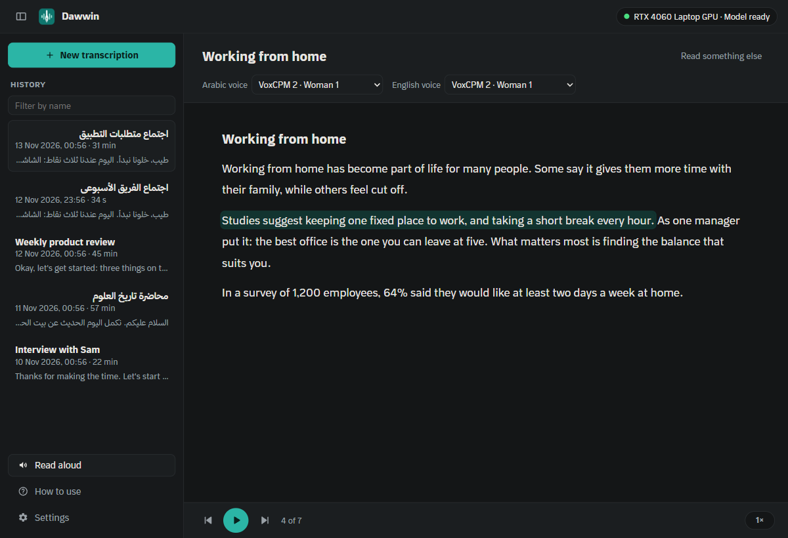
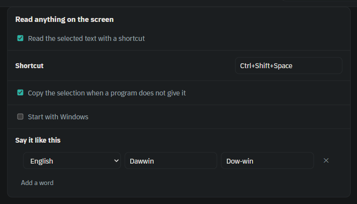
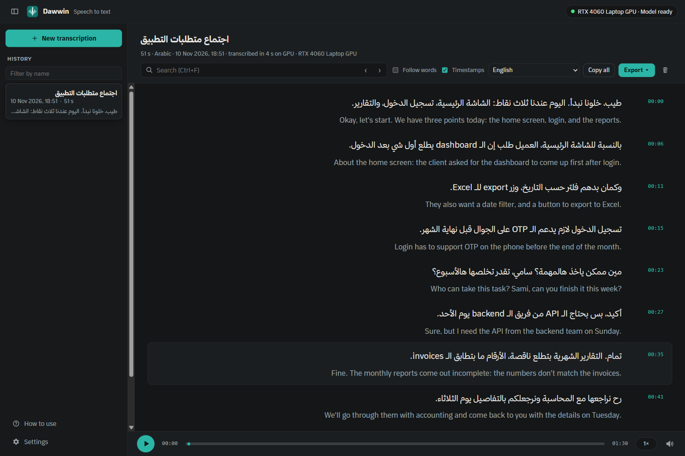
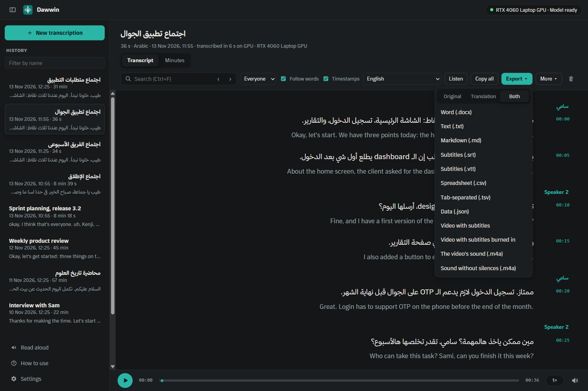

# Dawwin · دَوِّن

*Dawwin* means "write it down" in Arabic.

**Turn recordings, videos and meetings into text, translate it, subtitle them, write their minutes, and have any text read aloud, on your own Windows PC.**
Arabic first, with its dialects and the English words people mix into it, and about 100 other
languages. Translation into 46 languages. Record a Zoom, Meet or Teams call and read it as it is
said. And the other way round: any text, file, transcript or minutes read aloud in a natural voice, in
Arabic and English, and the text you select in any program read at a shortcut. Nothing leaves your
computer: no account, no upload, no subscription, no limit on hours.

**[Download the latest release](https://github.com/BaraaJadaan/dawwin/releases/latest)** · free and open source (MIT)

<div dir="rtl">

**دَوِّن** يفرّغ التسجيلات والفيديوهات إلى نص على حاسوبك، ويترجمها، ويضيف إليها نصًّا على الشاشة،
ويكتب محاضر الاجتماعات. العربية أولًا، بلهجاتها والكلمات الإنجليزية التي تتخللها، ونحو 100 لغة أخرى،
والترجمة إلى 46 لغة. ويسجّل مكالمات Zoom وMeet وTeams ويكتبها أثناء الكلام. ويقرأ لك أي نص أو ملف أو
تفريغ أو محضر بصوت طبيعي، بالعربية والإنجليزية، وأي نص تحدّده في أي برنامج بضغطة اختصار.
لاجتماعات العمل، والمحاضرات والدروس والخطب، والمقابلات والأبحاث، والفيديوهات والأفلام، والرسائل
الصوتية. لا شيء يغادر جهازك: لا حساب ولا رفع ولا اشتراك.

</div>


## What people use it for

- **Business meetings.** Press **Record** during a Zoom, Teams or Google Meet call: Dawwin records your
  microphone and what the PC plays, with no bot joining the call, and writes the meeting while it goes,
  each line marked Me or Them, the others told apart by voice. Or drop a recording of it. Either way you
  get the meeting as text you can search, correct and send as a Word document, with who said what.
  Requirement meetings in Arabic full of English terms ("الـ dashboard", "الـ API") come out as they
  were said, and the names of your company and products the way you write them. Then one press
  writes the minutes: a short summary, the decisions, and who does what by when, by name, written on
  your own computer instead of a cloud chatbot.
- **Colleagues who speak another language.** Translate the transcript and share it on its own, or as a
  bilingual document with each line and its translation under it.
- **Videos, courses and YouTube.** Subtitles timed the way professional ones are. Translate them to
  reach viewers in 46 languages, and add them to the video as tracks the viewer turns on and off, or
  burn them into the picture for WhatsApp, Instagram and players that show no tracks.
- **Films and series.** Subtitles for a film that has none, or none in your language. Dawwin writes
  them into the film's MKV, next to the tracks it already has.
- **Interviews and research.** Exact quotes with their time, every word searchable, and an export to
  CSV or JSON for analysis. Journalists, researchers and students keep their sources private.
- **Lectures, lessons and sermons.** University lectures, Arabic lessons, khutbahs and Quran
  recitations become text you can search and quote, with the recording a click away from any word.
- **Podcasts.** Transcripts and show notes for listeners and for search engines, and the long silences
  cut out of the sound.
- **Voice notes.** WhatsApp voice notes to text.
- **Accessibility.** Captions for people who are deaf or hard of hearing, and any text read aloud for
  people who find reading hard.
- **Listening instead of reading.** An article, a report, a PDF or an e-book read aloud while you do
  something else, or saved as a sound file for the road; a meeting's translation heard in the language
  you follow best.
- **Anything you are reading, read to you.** Select text in a browser, an email, a chat or a PDF and press
  a shortcut: Dawwin reads it in a natural voice, without copying and pasting it anywhere.
- **Learning a language.** Read along with **Follow words**, with the translation under each line.
- **Confidential recordings.** Legal, medical, HR and other private calls are transcribed on your
  own machine, never on someone else's server.

## Features

**Transcribe**

- Drop recordings and videos on the window: m4a, mp3, wav, flac, mp4, mov and mkv. With ffmpeg, also
  WhatsApp voice notes, webm, avi, wmv, flv, mpg, a camera's mts, m2ts and ts, aiff, caf and ac3:
  Dawwin offers it when a file needs it (a download of 1.3 MB), or uses one already on the PC. Several
  files queue up. The message while you drag a file over the window says what the ticked steps will do.
- Transcribe a whole folder, subfolders included. The transcripts are saved next to the recordings, and
  recordings that are already done are skipped, so a stopped run picks up where it left off. The files
  Dawwin wrote there itself (the sound, the videos with subtitles) are never taken for new recordings,
  and a folder of thousands of files, or a whole drive, shows how far it has looked and can be stopped.
- Choose the spoken language, and Dawwin uses the model that suits it. If that model is not on the PC
  yet, it offers to download it.
- The transcript appears line by line while it is written, in the direction of its language.
- **Follow words**: the word being said is highlighted as the recording plays. Ctrl+click a word, or
  select text and right-click → **Play from here**, to hear it.
- Long recordings stay quick: a three-hour meeting of 5,000 lines opens in a fifth of a second, and
  search answers each key at once (new in 1.3.2).
- Runs on the GPU of any brand (NVIDIA, AMD, Intel), or on the CPU when there is none.

**One drop, several steps** (new in 1.3)

- Choose on the start page what happens to what you drop, in order: take the long silences out and
  save the sound, transcribe, translate, and add the subtitles to the video, as tracks or burned in.
  Turn on only what you need: Dawwin runs the steps one after the other, and each one can also be done later on its own.
- Or pick a common job by name, and it ticks its steps: **Transcribe**, **Transcribe and translate**,
  **Video to sound file**, **Sound without silences** or **Video with subtitles** (new in 1.3.2).
- Save the sound and the videos next to the recording, or in a folder of your own (new in 1.3.2).


**Record a meeting** (new in 1.5)

- **Record** on the start page records your microphone and everything the PC plays, as two tracks:
  a Zoom, Meet or Teams call, a call in the browser, a webinar or a video. It listens to the PC, not to
  one program, so it works with any of them, and nothing joins the call. Dawwin's own sound is left out.
- The text appears while people speak, about half a minute behind, each line marked **Me** or **Them**.
  With **Tell speakers apart** ticked, the others are told apart by voice once you press Stop (Speaker 2,
  Speaker 3…, to rename like any speaker). **Detect the language** works here too: the first words
  spoken decide. Press Stop and the transcript is ready within moments: nothing is transcribed twice.
  The other steps ticked on the start page, such as a translation, follow, and Fix the timing, Follow
  words and subtitles hear each side on its own.
- With laptop speakers instead of headphones, the microphone hears the others too: echo cancellation
  (WebRTC's, in Rust) takes them out of your track, so their words are not written twice.
- Record both sides, the microphone alone (a lecture in a room) or the PC's sound alone (a webinar).
  Choose the microphone, or follow the Windows default; a headset plugged in or out mid-meeting is
  followed without a gap. A microphone that sends no sound (muted, or a virtual one with nothing behind
  it) is said at once, with the others to choose from.
- The recording survives a crash, a power cut or a forced close up to the last second or so, and is
  offered back at the next start. The PC does not sleep while it records, closing Dawwin asks first,
  and a disk running low is said before it is full.
- Kept as an M4A of about 45 MB an hour (with ffmpeg; as a WAV without it), with both sides to play back
  in Dawwin: in the folder chosen in Settings (**Where the sound, the videos and the recordings are saved**), or else in `Documents\Dawwin`.
  When Documents is in OneDrive, as Windows 11 often sets it up, they go to `Dawwin` in your user folder
  instead, so that a recording never leaves the computer; a folder you choose inside OneDrive is said
  plainly next to Record. The first time, Dawwin reminds you that recording a call may need everyone's
  consent.



**Who said what** (new in 1.4)

- Tick **Tell speakers apart**, and each line gets its speaker, named where the speaker changes. Up to
  four people are told apart, on the processor, in a small part of the recording's length; one
  download of 139 MB, offered when you tick it.
- Click "Speaker 2" and type "Sami": every line of that speaker says Sami. Merge two speakers that are
  one person, or give one line to someone else, or to someone new. A line that holds two people's
  words is split where the speaker changes, when there is a pause there.
- Names go into every export: "Sami:" before each turn in Word, text and Markdown, a speaker column in
  CSV and TSV, a speaker on each line of JSON, the voice tag of WebVTT, and, if you want it, the name
  at the start of a subtitle when the speaker changes. A translation keeps the same speakers.
- Search within one speaker's lines. **More ▾ → Find the speakers** does it for an older transcript.



**The language, and your words** (new in 1.4)

- **Detect the language**, at the top of the language menu: Dawwin listens to the first half minute of
  speech of each recording, so a folder in several languages is fine. A recording in a language you
  have no model for says which one it is and offers its model; the transcript says what was heard, and
  **More ▾ → Transcribe again in** fixes a wrong guess in one press. One download of 27 MB.
- **Words and names** in Settings: how to write the words Dawwin keeps getting wrong ("Thmanyah", not
  "ثمانية"), with the wrong forms they come out as if you know them. Every new transcript writes them
  your way, as whole words, whatever their diacritics or Latin case (another spelling is listed as
  a wrong form, so a name never replaces a word that only looks like it); an "All languages" (Whisper) model also
  hears them better. Select a word in a transcript and right-click → **Always write it like this…**, or
  **More ▾ → Apply my words** on an older one. Save the list to a file and load it on another PC.

**Translate** (new in 1.3)

- Translate a finished transcript into any of 46 languages, among them Arabic, English, French,
  Spanish, German, Turkish, Persian, Urdu, Hindi, Chinese and Danish. Each translated line appears
  under its line as it comes.
- Correct a translation by hand. A line you edit afterwards is marked as out of date, and translating
  again only redoes the lines that changed.
- Export or copy the transcript, the translation, or both: a bilingual Word document, two-line
  subtitles, or a spreadsheet with a translation column.

**Subtitles** (new in 1.3)

- Cut and timed by the rules Netflix and the BBC give their subtitlers: at most two lines of 42
  characters, on screen between 5/6 of a second and 7 seconds and slow enough to read, on when the
  speaker starts and off when they stop, and broken where a sentence ends or the speaker pauses, not
  in the middle of a phrase.
- **They follow the speaker** (new in 1.3.2): the speech models give no word times, so when subtitles or
  Follow words are first wanted, Dawwin listens to each stretch between two pauses again to learn which
  words fall in it. In our test 98 % of the words land within half a second of when they are said
  (47 % before), and no subtitle is gone before its last word. **Fix the timing** does it for older
  transcripts. See [the measurement](tools/timing/README.md).
- Chinese, Japanese, Korean, Thai, Lao, Khmer and Burmese get subtitles of their own line length (16
  characters in Chinese, 13 in Japanese, as Netflix's guides say), broken at their own punctuation,
  and a translation under them keeps its sentences whole (new in 1.3.2).
- SRT and WebVTT files of the transcript, of the translation, or of both.
- **Video with subtitles**: the video itself, with a subtitle track for each language. The picture and
  sound are copied untouched, so it takes seconds, even for a long film. MP4 and MOV videos give an
  MP4 (a MOV an MP4 cannot hold, such as ProRes from a camera, stays a MOV), everything else an MKV.
  The video's own subtitles stay exactly as they were, picture-based (PGS, VobSub) and styled (ASS) ones too.
- **Video with subtitles burned in**: the subtitles drawn on the picture, for WhatsApp, Instagram, TVs
  and players that show no tracks. Arabic is joined and runs right to left, its full stops and the
  English words in it in their place, and the picture is encoded again on the graphics chip (NVIDIA,
  AMD or Intel, or Windows' own encoder): about 5 seconds for a minute of 1080p video on an RTX 4060
  laptop. The new file is about the size of the original. The list on the side shows how far it is.
- **Subtitle look** (new in 1.4) in Settings: the size of the text in four steps, its font (those of
  your PC that draw Arabic correctly), white or yellow, an outline or a dark box behind it, at the
  bottom or the top, with a preview on a second of your own video. **Sharp text on small videos**
  enlarges a video under 1080p before drawing the text, so it is as sharp as on a 1080p one; the file
  gets about three times larger (on by default, and it says so on hover).
- Both need ffmpeg, which Dawwin downloads the first time you ask: 1.3 MB for subtitle tracks, 3.8 MB
  for burning in. Both are in **Settings**, to download or delete by hand.

**Sound** (new in 1.3)

- **Remove silences**: every pause longer than 0.7 seconds is shortened, and the silence before and
  after the speech goes. Transcribing what is left is faster, and the transcript still has the times
  of the original recording, so playback, Follow words and subtitles stay in step.
- Save the sound as a file of its own (M4A): from a video, or without its silences.

**Minutes** (new in 1.8)

- **Write the minutes** on a transcript's Minutes tab: a summary of a few sentences, the decisions, the
  action items (who, what, by when), the topics in order with their start times, and the questions left
  open. A lecture or an interview gets a summary and its topics, without empty decisions and actions.
- Tasks go to people by the names the transcript gives them: those you gave with **Tell speakers
  apart**, or Speaker 2. In a meeting you recorded, Dawwin tells the model that Me is you and Them the
  other side of the call.
- Every decision and action shows its time: press it to see the lines it came from in the transcript.
- In the language of the meeting, with its English terms as they were said, or in another language:
  the minutes of an Arabic meeting in English, without translating the transcript first.
- Correct any line by hand; your text is kept. **Write again** after correcting the transcript, with a
  warning that it replaces what you edited.
- A meeting of three hours is written in parts, with the progress shown; stop it and it carries on where
  it stopped, and the minutes cover the whole meeting.
- Export the minutes alone, or followed by the transcript, to Word, Markdown or text. A step on the start
  page writes them after the transcript, and a folder run saves them next to each recording. While you
  record a meeting they wait, so the recording keeps the engine and the GPU, and carry on after it.
- Written on your computer by a model you download once in Settings, chosen by measuring (see below).
  The panel offers the models with their sizes and says which fits your computer.



**Read aloud** (new in 1.8)

- Drop a text file, Markdown, a web page saved as HTML, a Word document, subtitles (SRT, VTT), a PDF, an
  e-book (EPUB) or a picture of text on **Read aloud**, or paste text, and press play. Code blocks, link
  addresses, image paths and subtitle times are left out; old Arabic text files in Windows-1256 read right.
- PDFs are read in the right order, also in Arabic (the first one brings PDFium, 3 MB). An e-book shows
  its chapters to go to. Pictures of text and scanned PDFs are read by Windows' own text recognition,
  which says which Windows language to add when it cannot read one.
- **Listen** on any transcript reads it, or its translation when one is shown. In a meeting whose speakers
  were told apart, or one you recorded, each person reads in a voice of their own, their name shown where
  they start. **Listen** on the Minutes tab reads the minutes.
- Sentence by sentence, the one being read marked and the page following it: pause, back and forward a
  sentence, click any sentence to read from there, and choose the speed. Dawwin remembers where you
  stopped in each file, and breathes a little at the end of a paragraph and after a heading.
- Arabic and English each have their own voice, a man's or a woman's. An English sentence inside Arabic
  is read by the English voice; a single English word stays with the Arabic one. Numbers, dates, times,
  percentages and money are read as words, in the language around them.
- Three voices, chosen by ear in a blind listening test (below): **VoxCPM 2**, the most natural, wants
  a graphics card; **Supertonic 3** reads Arabic and English on any processor; **Phonon 31M** reads
  English and is the smallest. Hear each one in **Settings** before you download it. A voice that needs
  the graphics card waits while Dawwin records, transcribes, translates or writes minutes on it, and says
  so. The voices run on your PC like everything else: the text never leaves it.
- **Save as sound**: the reading as a sound file to listen to away from the computer, M4A, or M4B with a
  chapter for each chapter of a book. It is made in the list of jobs, with its progress, and can be
  stopped there.



**Read anything on the screen** (new in 1.8)

- Select text in any program, a web page, a Word document, a PDF, an email or a chat, and press
  **Ctrl+Shift+Space**: Dawwin reads it in the voices of Read aloud, in a small player at the corner of the
  screen that leaves the keyboard where it was, with pause and back and forward a sentence. Press the
  shortcut again to stop. Turn it on in **Settings → Read anything on the screen**, where the keys can be
  changed; if another program already uses them, Dawwin says so and offers free ones.
- While the shortcut is on, closing Dawwin's window keeps it in the notification area, ready; **Start with
  Windows** (off until you turn it on) starts it there when you sign in. Starting Dawwin again opens its
  window.
- Dawwin asks the program for its selection through Windows' accessibility interface. Where a program
  does not give it that way, Dawwin presses Ctrl+C for you and puts back what you had copied, text,
  pictures and all, also when a busy program copies late, and takes its copy out of the clipboard
  history. Never in a terminal, where Ctrl+C would stop the running program, and it can be turned off.
  With nothing selected, it says so instead of reading old text. In a window that runs as administrator,
  Windows lets no ordinary program read, and Dawwin says that too.
- **Say it like this**: names and terms the voice says wrongly, with how to say them, for Arabic and for
  English sentences.
- Tried so far only on a test window of its own (a standard text box, one that only answers Ctrl+C, and
  one that answers it 0.9 s or 3.5 s late), not yet in Chrome, Edge, Firefox, Word, Outlook, a PDF
  viewer, VS Code, Windows Terminal, WhatsApp or Telegram: it is built for them, and how each answers is
  still to be seen. Known not to give their selection: a terminal that shows Windows no text (PuTTY,
  mintty, VS Code's terminal), where Dawwin says so rather than press Ctrl+C; any window run as
  administrator; and Firefox before its UI Automation, which needs the Ctrl+C way.




**Edit, search and export**

- Correct lines in place, and search with Arabic in mind: أ/إ/ا, ة/ه and ى/ي match.
- Export to Word, text, Markdown, subtitles (SRT, VTT) or data (CSV, TSV, JSON). A line that starts
  with `=` or holds `<` comes out as text in every spreadsheet and player.
- English or Arabic interface, and a **How to use** page with pictures of every part of the app.
- Short descriptions on hover, in both languages, where a name cannot say everything (new in 1.3.2).

**For everyone** (new in 1.3.2)

- Works with the keyboard alone: Tab reaches every transcript and job, Enter opens it, Escape closes a
  menu, and the focus always shows. Ctrl and plus or minus enlarge the whole interface, and it keeps
  the size. With animations turned off in Windows, nothing moves.
- Behind the proxy of a university or a company: downloads use the one Windows is set to use (or
  `HTTPS_PROXY`), and if they cannot connect, Dawwin says why, next to the way to download by hand.
- A job that goes wrong fails on its own, and the next one runs; a graphics driver that hangs while a
  model loads is given five minutes, then the job goes on the CPU.

<table>
  <tr>
    <td width="50%"><br>A meeting in Arabic, with its English translation under each line.</td>
    <td width="50%"><br>Export the original, the translation or both, or add them to the video.</td>
  </tr>
  <tr>
    <td><br>Read the text while it is being written. The rest of the queue waits its turn.</td>
    <td><br>Search the transcript and export it in eight formats.</td>
  </tr>
  <tr>
    <td><br>Select a word and right-click to hear it being said.</td>
    <td><br>The whole interface also comes in Arabic, right to left.</td>
  </tr>
  <tr>
    <td><br>Choose a language and a model. The download survives pausing, closing the app and a lost connection.</td>
  </tr>
</table>

## Getting started

1. Download `Dawwin_x.y.z_x64-setup.exe` from
   [Releases](https://github.com/BaraaJadaan/dawwin/releases) and run it. Windows may say the app is
   unrecognised: choose **More info → Run anyway**. Or use the portable `.zip`: unpack it and run `dawwin.exe`.
2. Choose the language of your recordings, then a model. No account is needed, and you only need the
   models for the languages you use.

   | Model | For | Download | |
   | --- | --- | --- | --- |
   | **Arabic, full quality** (Cohere Q8) | Arabic with its dialects, English | 2.4 GB | The most accurate. About 3 GB of GPU memory. |
   | **Arabic, smaller** (Cohere Q4) | Arabic with its dialects, English | 1.6 GB | Almost as accurate. For weaker PCs and slow connections. About 2 GB of GPU memory. |
   | **European languages** (Canary 1B v2) | 25 languages: Danish, French, Spanish, German, Russian, … | 0.7 GB | Accurate and fast, also without a GPU. |
   | **All languages** (Whisper large-v3 turbo) | About 100 languages: Turkish, Persian, Hindi, … | 0.5 GB | Accurate, but much slower without a GPU. |

   The download can be paused. If the connection drops or Dawwin closes, it carries on from where it
   stopped. Already have the file? Press **I have the file**: any Cohere Transcribe, Canary or Whisper
   GGUF file works.
3. Drop a recording or a video on the window.
4. To translate, pick a language in the menu above the transcript. The first time, Dawwin asks for a
   translation model, which you download in **Settings → Translation**. The translator that runs it
   (llama.cpp, 14 MB) comes along with the first one:

   | Model | Download | |
   | --- | --- | --- |
   | **Translation, best quality** (MiLMMT-46 12B) | 7.3 GB | The best of the ten open translation models we tested. Fast with a GPU of 8 GB, slow without one. |
   | **Translation, smaller** (MiLMMT-46 4B) | 2.5 GB | As good as the best one from and into Arabic, a little less in other languages. Faster without a GPU. |
   | **Translation, smallest** (MiLMMT-46 1B) | 0.8 GB | For slow connections and older computers: fast on any of them, a little less accurate. |
5. To write the minutes of a meeting, open the **Minutes** tab of its transcript. The first time, download
   a minutes model there or in **Settings → Minutes**. The translator runs it too:

   | Model | Download | |
   | --- | --- | --- |
   | **Minutes, best** (Jais-3 7B) | 5.6 GB | The best of the 20 open models we tested, in Arabic and in English. Fits a GPU with 8 GB, slow without one. |
   | **Minutes, smaller** (Ministral 3 3B) | 2.1 GB | Good minutes at under half the size. Fits a GPU with 4 GB. |
   | **Minutes, smallest** (Jais-3 0.9B) | 0.7 GB | For older computers: fast on any of them, but it misses more of the decisions and tasks. |

6. To have something read aloud, open **Read aloud** and download a voice in **Settings → Read aloud**,
   after hearing it. The voice program (11 MB) comes with the first one, and the graphics card's part of
   it (13 MB) with VoxCPM 2:

   | Voice | Reads | Download | |
   | --- | --- | --- | --- |
   | **VoxCPM 2** (OpenBMB) | Arabic and English, a man and a woman in each | 3.0 GB | The most natural. Wants a graphics card; while Dawwin records, transcribes, translates or writes minutes on it, it waits. |
   | **Supertonic 3** (Supertone) | Arabic and English, five men and five women | 0.3 GB | Fast on any processor: it reads faster than it speaks without a GPU. |
   | **Phonon 31M** (Gradium) | English, two men and three women | 87 MB | The smallest, and the fastest. |

7. To have text you select in other programs read, turn on the shortcut in **Settings → Read anything
   on the screen**, select some text and press **Ctrl+Shift+Space**. It reads in the voices of step 6.

With the Arabic model on an RTX 4060 laptop GPU, 24 minutes of audio take about 40 seconds. On an 8-core
laptop CPU, it runs about 3 to 4 times faster than real time. On a small cloud CPU without a GPU, Canary
ran about 7 times faster than real time, and Whisper about as fast as real time. The smaller
translation model translated a short line in about 2 seconds on a small cloud CPU without a GPU. On the
same kind of CPU, the minutes of a meeting of eight minutes took about 4½ minutes with Jais-3 7B and
under a minute with Jais-3 0.9B.

**Requirements:** Windows 10 or 11 (64-bit), 8 GB of RAM (16 GB for the best translation or minutes model
without a GPU), and room for the models. The installer is small (about 10 MB): the translator, ffmpeg,
the voice program and PDFium download only for those who use them.

## How the translation models were chosen

We gave ten open translation models that run on a PC the same sentences from Google's
[WMT24++](https://huggingface.co/datasets/google/wmt24pp) test set, through the same engine, and scored
their translations with COMET-22 (higher is better). The Arabic side of the test is Saudi dialect, close
to how people talk in a meeting.

| Model | Size | Arabic ⇄ English (300 sentences) | 7 directions (280 sentences) |
| --- | --- | --- | --- |
| Tencent Hy-MT2 7B | 4.6 GB | **79.9** | 82.3 (weak in Danish) |
| **Xiaomi MiLMMT-46 12B** | 7.3 GB | 79.2 | **84.3** |
| **Xiaomi MiLMMT-46 4B** | 2.5 GB | 79.0 | 83.7 |
| Google TranslateGemma 12B | 7.3 GB | | 83.3 |
| Tencent Hy-MT2 1.8B | 1.1 GB | 77.6 | 77.5 |
| Xiaomi MiLMMT-46 1B | 0.8 GB | 76.8 | 81.8 |
| PFN PLaMo 3 Translate 8B | 5.3 GB | | 77.1 (no Danish or Turkish) |

The seven directions are Arabic, Danish and Turkish to and from English, and English to French. All the
numbers, and the test itself, are in [tools/bench-translate](tools/bench-translate).

## How the minutes models were chosen

We had 20 open models that run on a PC write the minutes of eight recordings made up for the test, the
way Dawwin asks for them: meetings in Levantine, Gulf and Egyptian Arabic, one in Arabic and English
mixed, a lecture in Modern Standard Arabic, and three in English, each also in the other language and
two in parts as a long meeting goes. Their minutes were scored against minutes written by hand: the
decisions and tasks found (at the lines they were said), who and by when, the key facts in the summary,
the topics, and whether the minutes are in the language asked for. Score out of 100:

| Model | Size | Score | Arabic | English | In the other language | Decisions found | Tasks found |
| --- | --- | --- | --- | --- | --- | --- | --- |
| **Jais-3 7B** | 5.6 GB | **88.7** | **89.8** | 86.9 | **91.6** | 83 % | 87 % |
| Mistral Ministral 3 8B | 5.2 GB | 85.8 | 87.5 | 82.9 | 70.3 | 88 % | 93 % |
| Google Gemma 4 12B | 7.1 GB | 83.9 | 82.5 | 86.2 | 88.8 | 88 % | 93 % |
| IBM Granite 4.2 8B | 5.4 GB | 82.6 | 82.2 | 83.3 | 66.7 | 83 % | 87 % |
| Alibaba Qwen3.5 4B | 2.7 GB | 80.0 | 81.2 | 77.9 | 79.1 | 88 % | 97 % |
| Alibaba Qwen3.5 9B | 5.7 GB | 79.2 | 76.9 | 83.2 | 82.5 | 92 % | 90 % |
| **Mistral Ministral 3 3B** | 2.1 GB | 78.7 | 81.2 | 74.5 | 72.6 | 71 % | 100 % |
| Mistral Ministral 3 14B | 8.2 GB | 76.0 | 76.0 | 76.0 | 64.1 | 92 % | 97 % |
| Jais-3 3.7B | 3.2 GB | 74.1 | 69.9 | 80.9 | 72.0 | 84 % | 90 % |
| Google Gemma 4 E2B | 3.1 GB | 72.2 | 71.1 | 74.0 | 70.4 | 76 % | 83 % |
| **Jais-3 0.9B** | 0.7 GB | 65.0 | 61.5 | 70.8 | 56.9 | 56 % | 63 % |
| Alibaba Qwen3.5 2B | 1.3 GB | 48.3 | 36.6 | 67.9 | 62.4 | 85 % | 80 % |
| Alibaba Qwen3.5 0.8B | 0.5 GB | 26.7 | 25.0 | 29.5 | 26.8 | 53 % | 44 % |

Most of the lower scores in Arabic are minutes written in English when Arabic was asked for. Qwen3.5 4B
finds as much as the best, but its summaries of the Arabic meetings say nothing ("no one attended").
Dawwin offers the best (Jais-3 7B, which also fits a GPU with 8 GB, its context kept in 8 bits), the best
for its size (Ministral 3 3B) and the smallest that is still usable (Jais-3 0.9B). With the context in
8 bits, as on a GPU, they scored 87.6, 77.9 and 70.7. The models, the scoring and all the numbers are in
[tools/bench-minutes](tools/bench-minutes/results-1.8.0.md).

## How the voices were chosen

Seven open voice models that run on a PC read the same Arabic and English passages, each sentence on its
own as Dawwin reads: plain Arabic, the same with tashkeel, Gulf, Egyptian and Levantine sentences,
Arabic with English inside, numbers and dates, and long passages. Their names were hidden behind letters,
and the voices were chosen by ear. On GitHub's processors (4 threads, no GPU), the time each took for a
second of speech:

| Model | Size | Seconds per second of speech | Memory |
| --- | --- | --- | --- |
| **Phonon 31M** (English only) | 85 MB | **0.38** | 0.7 GB |
| **Supertonic 3** | 0.3 GB | **0.70** | 0.5 GB |
| LFM3-Audio 2B | 2.1 GB | 1.46 | 3.9 GB |
| **VoxCPM 2** | 3.0 GB | 7.4 | 7.0 GB |
| Chatterbox Multilingual V3 | 2.1 GB | 9.6 | 3.7 GB |
| Magpie TTS 357M | 1.6 GB | 14.4 | 2.1 GB |

Under 1 reads faster than it speaks. Open models are still behind the best paid services in Arabic (on
the public [Arabic TTS Arena](https://huggingface.co/spaces/Navid-AI/Arabic-TTS-Arena) all open ones
score alike, well under the best closed one), so these are the most natural that may be offered freely,
not the most natural there are. The test and its texts are in [tools/bench-voice](tools/bench-voice).

## Building from source

You need [Rust](https://rustup.rs), the Visual Studio C++ Build Tools, CMake and Node.js. For GPU
support, also the [Vulkan SDK](https://vulkan.lunarg.com); without it the engine is built for the CPU.

```bash
npm install
npm run engine
npm run build
```

The installer and a portable zip of the current version land in `dist/`, with their checksums.

How the app is put together, and how to release it: [docs/how-it-works.md](docs/how-it-works.md).
`cargo test` in `src-tauri` runs the unit tests; [tools/e2e](tools/e2e) has the tests that drive the real
app, with recordings they make themselves.

## Contributing

Contributions are welcome: bug reports, fixes, translations of the interface and new features. Please
contact me before starting on something bigger, so we can agree on the approach: open an
[issue](https://github.com/BaraaJadaan/dawwin/issues), email me at
[braajad1@gmail.com](mailto:braajad1@gmail.com), or reach me on GitHub
([@BaraaJadaan](https://github.com/BaraaJadaan)). Then send a pull request.

Questions, ideas and problems are welcome by email too: [braajad1@gmail.com](mailto:braajad1@gmail.com).

If Dawwin is useful to you, a star on GitHub helps other people find it.

## Privacy

Dawwin goes online only when you ask it to: to download a model or a voice (from
[Hugging Face](https://huggingface.co)) or a tool (the translator, ffmpeg, the voice program and PDFium,
from this repository's [releases](https://github.com/BaraaJadaan/dawwin/releases)), and to check for
updates (from GitHub; also at startup if you turn that on in Settings). Recordings, transcripts,
translations, minutes and what is read aloud stay on your computer. A meeting you
record is captured from your own microphone and speakers only: nothing joins the call, and the
recording is never sent anywhere. Recording a call may still need the consent of everyone on it, which
Dawwin reminds you of before the first recording. Text you select in other programs to have it read is
read on your computer and kept nowhere: not in History, not in a log, not even its place, and the sound
made of it is deleted when the reading stops. Where Dawwin has to press Ctrl+C to get it, the program
copies it: Dawwin then takes that copy out of Windows' clipboard history (Win+V) and puts back what you
had copied. If your clipboard syncs to your other devices (Settings → System → Clipboard), Windows may
already have sent the copy there; turn off copying the selection in Dawwin's Settings to avoid it. The
translator, which also writes the minutes, listens only to Dawwin on the same computer, with a key it
is given at start.

## Uninstall

Uninstall Dawwin from Windows Settings → Apps; it no longer starts with Windows. The models and your
transcripts are kept in case you reinstall. To remove them too, delete the folders `%LOCALAPPDATA%\Dawwin` and `%APPDATA%\Dawwin` (and
the model folder, if you chose another place for it).

## License

[MIT](LICENSE). These are not part of this repository and have their own terms:

- **The speech models**: Cohere publishes its model under Apache-2.0, NVIDIA publishes Canary under CC
  BY 4.0, and OpenAI publishes Whisper under the MIT license. Dawwin downloads GGUF conversions of
  [Cohere](https://huggingface.co/handy-computer/cohere-transcribe-arabic-07-2026-gguf),
  [Canary](https://huggingface.co/handy-computer/canary-1b-v2-gguf) and
  [Whisper](https://huggingface.co/handy-computer/whisper-large-v3-turbo-gguf) made by the
  [transcribe.cpp](https://github.com/handy-computer/transcribe.cpp) project.
- **The translation models**: Xiaomi's [MiLMMT-46](https://huggingface.co/collections/xiaomi-research/milmmt-46)
  is built on Google's Gemma 3 and published under the [Gemma Terms of Use](https://ai.google.dev/gemma/terms).
  Dawwin downloads GGUF conversions of the [12B](https://huggingface.co/mradermacher/MiLMMT-46-12B-v1.0-GGUF),
  the [4B](https://huggingface.co/mradermacher/MiLMMT-46-4B-v1.0-GGUF) and the
  [1B](https://huggingface.co/mradermacher/MiLMMT-46-1B-v1.0-GGUF) made by mradermacher.
- **Who said what, and the language**: NVIDIA publishes
  [Streaming Sortformer 4spk v2.1](https://huggingface.co/nvidia/diar_streaming_sortformer_4spk-v2.1)
  under the [NVIDIA Open Model License](https://www.nvidia.com/en-us/agreements/enterprise-software/nvidia-open-model-license/):
  commercial use is allowed, NVIDIA's Trustworthy AI terms apply, and whoever passes the model on gives
  its license and the notice "Licensed by NVIDIA Corporation under the NVIDIA Open Model License" with
  it. SpeechBrain publishes [VoxLingua107 ECAPA-TDNN](https://huggingface.co/speechbrain/lang-id-voxlingua107-ecapa)
  under Apache-2.0. Dawwin downloads the GGUF conversions of
  [the speaker model](https://huggingface.co/handy-computer/diar_streaming_sortformer_4spk-v2.1-gguf) and
  [the language model](https://huggingface.co/handy-computer/lang-id-voxlingua107-ecapa-gguf) made by
  transcribe.cpp, from their pages, which carry both licenses.
- **The minutes models**: [Jais-3](https://huggingface.co/inception42/Jais-3-7B) and Mistral AI's
  [Ministral 3](https://huggingface.co/mistralai/Ministral-3-3B-Instruct-2512) are published under
  Apache-2.0. Dawwin downloads the GGUF files of Jais-3 [7B](https://huggingface.co/IFM/Jais-3-7B-GGUF)
  and [0.9B](https://huggingface.co/IFM/Jais-3-0.9B-GGUF) published by IFM, and of
  [Ministral 3 3B](https://huggingface.co/mistralai/Ministral-3-3B-Instruct-2512-GGUF) published by Mistral AI.
- **The voices**: OpenBMB publishes [VoxCPM 2](https://huggingface.co/openbmb/VoxCPM2) under Apache-2.0;
  its ready-made voices in Dawwin were made by VoxCPM 2 itself from a written description, not from a
  real person. Supertone publishes [Supertonic 3](https://huggingface.co/Supertone/supertonic-3) under the
  [BigScience OpenRAIL-M](https://huggingface.co/Supertone/supertonic-3/blob/main/LICENSE) license: free to
  use, except for the uses its Attachment A forbids, and whoever passes it on passes those restrictions
  on; Dawwin shows the license before the download. Gradium publishes
  [Phonon 31M](https://huggingface.co/gradium/phonon-31m-en-audiocpp) and its
  [voices](https://huggingface.co/gradium/phonon-voices) under Apache-2.0. Dawwin downloads the GGUF
  conversions of VoxCPM 2 and Supertonic 3 made by the [audio.cpp](https://huggingface.co/audio-cpp/audio.cpp-gguf) project.
- **The engines**: [transcribe.cpp](https://github.com/handy-computer/transcribe.cpp) and
  [llama.cpp](https://github.com/ggml-org/llama.cpp), both under the MIT license, and for the voices
  [audio.cpp](https://github.com/0xShug0/audio.cpp)'s official library, under Apache-2.0, around which
  Dawwin's own voice program ([voice](voice)) is built.
- **PDFium**: Google's PDF library, under the BSD 3-Clause license, in the Windows build of
  [pdfium-binaries](https://github.com/bblanchon/pdfium-binaries) (MIT). It holds FreeType (FreeType
  License), ICU, zlib, libpng, libjpeg-turbo, OpenJPEG, Little CMS, HarfBuzz, Abseil, Highway, AGG 2.3,
  simdutf and fast_float; the download carries all their licenses.
- **ffmpeg**: Dawwin's own builds of [FFmpeg](https://ffmpeg.org), under the LGPL 2.1, made by
  [tools/ffmpeg/build.sh](tools/ffmpeg/build.sh) from FFmpeg's source. The one for video also holds
  [libass](https://github.com/libass/libass), [FreeType](https://freetype.org),
  [HarfBuzz](https://github.com/harfbuzz/harfbuzz) and [FriBidi](https://github.com/fribidi/fribidi).
  Each download carries their licenses and says where their source is.
- **Echo cancellation**: [sonora](https://github.com/dignifiedquire/sonora), a Rust port of the WebRTC
  project's audio processing, under the BSD 3-Clause license.
- **The font**: official builds embed [Thmanyah Sans](https://font.thmanyah.com), © Thmanyah Publishing
  and Distribution. Its license does not allow sharing the font files, so builds from this repository
  use the system font instead.
